# Ophylla Urban OS

**An executive command environment for the COO — Smart Cities & Innovation role at Ophylla Ventures.**

Ophylla Urban OS is a working, interactive prototype of the operating system a smart-city COO would use to run a portfolio of physical assets, digital twins and client delivery. It was built as a role-specific demonstration: the interface is not a slide deck, and the 3D twin, AI copilot, carbon ledger and P&L cockpit are interactive.

> **Demo data notice:** All portfolio, financial, sensor and asset data in this environment is illustrative. It is not Ophylla disclosure. The executive brief deliberately avoids claiming qualifications that are not evidenced; see the integrity position in the brief.

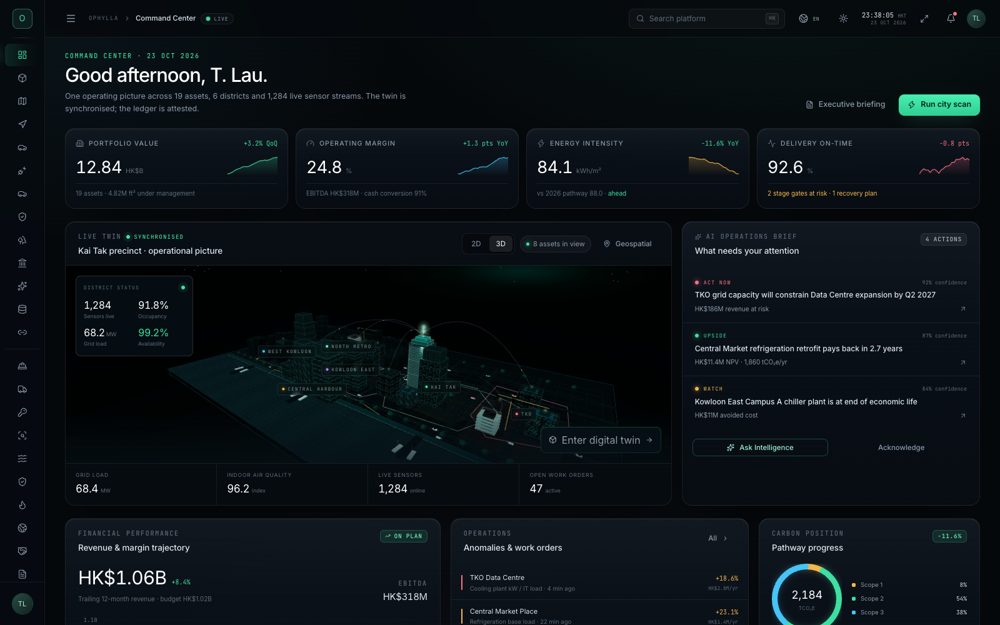

## Live modules

| Route | Module | What it demonstrates |
| --- | --- | --- |
| `/` | Command Center | Opens in a live **3D city** with a 2D map toggle: 19 assets, 6 districts, 1,284 sensor streams, executive decision queue and AI operations brief. |
| `/twin` | Digital Twin | Interactive 3D city, BIM floor explosion, GIS district context, IoT beacons, live traffic, transit, typhoon/heat resilience scenarios and an asset inspector. |
| `/factory` | Offsite Factory | 3D prefab factory: robotic weld cells, conveyor, modules, AGVs, quality gate, takt and offsite carbon benefit. |
| `/waste` | Waste & Circularity | 3D construction waste yard: material streams, skips, crusher, conveyor, diversion, carbon avoided and material value. |
| `/contracts` | Contracts & Claims | 3D contract portfolio: obligations, claims, time bars, renewals and exposure across six contracts. |
| `/procurement` | Procurement | 3D procurement control tower: six tender packages, bidders, award gate, savings, single-source risk and supply shocks. |
| `/supply` | Supply Chain | 3D global construction supply-chain twin: supplier nodes, sea/air/road lanes, inventory, risk, lane carbon and disruption scenarios. |
| `/fire` | Fire & Life Safety | 3D fire-safety twin: compartments, detection, sprinklers, smoke extract, egress and fire-service access. |
| `/safety` | Site Safety | 3D construction safety command: hazard zones, crane lift exclusion, fire points, evacuation route, typhoon readiness, permits and emergency sequence. |
| `/utilities` | Underground Utilities | 3D utilities corridor: water, power, telecom, gas, drainage, cooling, clashes, cover, sensors and emergency isolation. |
| `/quality` | Quality & Inspection | 3D construction quality: hold points, drone scans, defect pins, NCRs and rework across concrete, steel and fit-out. |
| `/handover` | Commissioning & Handover | 3D close-out twin: systems, tests, snags, asset tags, O&M, training and handover gate. |
| `/fleet` | Fleet & Equipment | 3D construction plant yard: tower crane, excavators, loader, telehandler, generator and drone, with utilisation and maintenance. |
| `/construction` | Construction Twin | 4D site sequence, tower crane, excavation, safety geofences, drone point cloud, BIM-to-field variance, 5D earned-value control and an ISO 19650 common data environment. |
| `/design` | Generative Design | 3D massing options compared on GFA, FAR, height, units, daylight, embodied carbon, cost and public realm before BIM freeze. |
| `/bim` | BIM Studio | A federated construction-site BIM demo: architecture, structure, MEP/FP, clash detection, LOD 200/350/500, 4D stages, COBie assets and a live clash register. |
| `/bim-site` | BIM on Site | Live Kai Tak construction site: Tower A structure, tower cranes, 4D sequence, discipline federation, clashes, logistics and as-built scan. |
| `/bim-workflows` | BIM Workflows | Ten-tool BIM toolchain (Revit, ArchiCAD, SketchUp, Rhino, Vectorworks, AutoCAD, Plannerly, Trimble Connect, Revizto, BIMcollab) plus Proptech.AI access, occupancy and visitor operations. |
| `/bim-xr` | BIM XR | Holographic data-centre BIM twin with 32 racks, containment, power, cooling, network, live telemetry, exploded view and AI layout generation. |
| `/port` | Port & Logistics | 3D container terminal: vessel, STS cranes, yard blocks, trucks, rail, gate, throughput and emissions. |
| `/water` | Water & Circularity | 3D water utility twin: reservoir, treatment, pumps, network pressure, leaks, quality, water tower and greywater reuse. |
| `/esg-building` | ESG Building Twin | A 12-storey 3D ESG building demo with floor-level energy, carbon, water, wellbeing, certifications and AI retrofit actions. |
| `/esg-world` | ESG World Model | Causal 2026–2050 precinct model linking BIM quantities, structural materials, construction logistics, operational energy, PropTech occupancy, climate risk and asset value. |
| `/maintenance` | Maintenance & Work Orders | 3D maintenance twin: work orders, SLA clocks, technicians, spares and BMS-triggered jobs across four floors. |
| `/assets` | Asset Lifecycle | 3D asset lifecycle: structure, façade, MEP, lifts, ICT and fit-out with condition, remaining life, capex and criticality. |
| `/power` | Electrical Distribution | 3D electrical room: transformers, LV switchgear, busbars, ATS, UPS, capacitor bank, generator, load and outage response. |
| `/plant` | Plant & BMS | 3D plant-room twin: chillers, pumps, cooling tower, AHU, BMS controller, chilled-water pipework, energy and maintenance. |
| `/dc-ops` | DC Operations | OCEAN-style 3D data centre operations: AI energy optimisation, cooling analytics, predictive maintenance, alerts, capacity and open ecosystem. |
| `/acoustics` | Acoustics & Vibration | 3D concert-hall and workplace acoustics: RT, clarity, noise, privacy, reflectors and rail vibration. |
| `/seismic` | Seismic Resilience | 3D seismic structural twin: base isolators, viscous dampers, eight floors, drift, acceleration and damage under three earthquake levels. |
| `/facade` | Facade Lab | 3D unitised facade mock-up: panels, mullions, brackets, thermal break, wind, rain, U-value and installation QA. |
| `/ground` | Ground Engineering | 3D geotechnical model: soil strata, boreholes, groundwater, pile group, settlement and excavation scenarios. |
| `/engineering` | Structural & Civil | 3D structural frame with load cases, utilisation heatmap, deflection shape, geotechnical inset and a cable-stayed harbour link with load-test animation. |
| `/workplace` | Workplace | 3D smart workplace floor: desk and room utilisation, comfort, energy, bookings and tenant experience. |
| `/proptech` | PropTech Stack | 16-floor leasing cutaway coloured by lease, occupancy, energy or tenant experience; floor selection, rent roll, pipeline, certifications, green-lease clauses and explode view. |
| `/heritage` | Heritage & Reuse | 3D heritage adaptive reuse: masonry façade, arches, timber roof, new core, gallery insertions, courtyard and carbon avoided. |
| `/place` | Public Realm | 3D placemaking twin: lawns, market square, water garden, event stage, play, transit arrival, canopy, footfall and access. |
| `/resilience` | Resilience | 3D emergency operations: typhoon wind and rain, storm surge, flood extent, power outages, shelters, pumps and response routes. |
| `/vehicles` | Vehicle Studio | Real-time 3D showroom: sedan, SUV, van, bus and truck with paint, wheels, interiors, lights and studio reflections. |
| `/ev` | EV Charging | 3D charging hub: solar canopy, DC fast and AC chargers, vehicles, battery storage, grid, demand response and outage islanding. |
| `/traffic` | Traffic & Junctions | 3D city intersection: adaptive signals, cars, bus, cyclists, pedestrians and buildings, with flow, safety, transit and emissions. |
| `/mobility` | Mobility | 3D smart-city mobility twin: autonomous loop, bus/rail interchange, ferry, drones, EV charging, curb management, mode share and carbon per trip. |
| `/map` | Geospatial | 2D choropleth and a fully interactive **3D GIS** mode, with asset, sensor, transit and flood layers, spatial query and district ranking. |
| `/data` | Data & AI Governance | 3D data mesh: seven domains, 102 products, quality, lineage, access policy and AI model nodes. |
| `/intelligence` | Intelligence | 3D decision graph linking data, models, agents, decisions and human gates; governed AI copilot, anomaly engine, model registry and guardrails. |
| `/cyber` | Cyber & OT | 3D security twin: IT/OT zones, cloud, BIM, BMS, SCADA, IoT, identity, vendors, attack paths and response. |
| `/trust` | Trust Ledger | 3D blockchain ledger chain with selectable SHA-256 blocks, provenance records, carbon attestations, independent verification and an auditable smart-contract view. |
| `/people` | People & Talent | 3D organisation and talent graph: COO, seven functions, capacity, critical skills, open roles and succession. |
| `/war-room` | Agent War Room | 3D room where eight AI specialists debate an incident, quarter close or design review, with evidence, challenge and a human gate. |
| `/agents` | Agent Operations | A 3D council of eight specialist agents, live orchestration, four human decision gates, company-function scorecard and a board pack. |
| `/esg` | ESG & Climate | 3D low-carbon district twin, carbon/nature lenses, baseline–transition–net-zero scenarios, GRESB/BEAM/LEED/WELL/TCFD framing, whole-life carbon, climate risk, social value and assurance. |
| `/energy` | Energy & Grid | 3D electrical and microgrid twin with CLP 11 kV connection, transformers, switchgear, BESS, solar, wind, generators, critical load and island-mode simulation. |
| `/labs` | Innovation Lab | 3D venture portfolio: six ventures around an AI core, experiments, TRL, IP, capital and value. |
| `/deals` | Deal Room | 3D corporate development: target, six diligence workstreams, IC gates, synergy rings and bid stages. |
| `/insurance` | Insurance & Risk | 3D insurance programme: six policies, limits, deductibles, premiums, claims and typhoon/cyber catastrophe exposure. |
| `/capital` | Capital & Investors | 3D capital stack: green grant, equity, mezzanine and senior debt, investor register, returns, covenants and use of proceeds. |
| `/portfolio` | Portfolio & P&L | Scenario-based P&L, capital allocation, stage gates, risk heatmap and an interactive 3D capital landscape whose towers encode committed capital and delivery health. |
| `/architecture` | Platform Architecture | BIM/GIS/twin/AI reference architecture with a 3D layered platform stack, data flows, security, governance and NFRs. |
| `/brief` | Executive Brief | Screen-only 3D COO decision room with five mandate pillars, plus a print-ready 90-day plan, evidence map, ATS keyword map and interview narrative. |

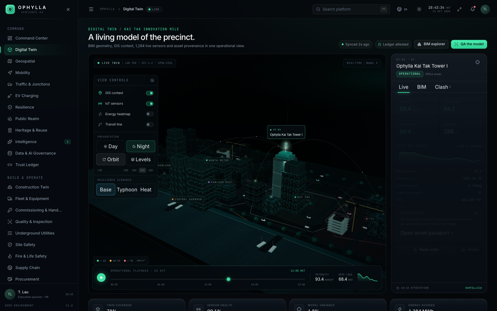

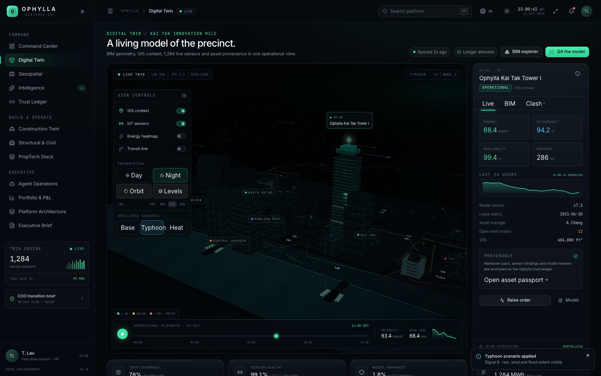

## 3D and interaction notes

- **BIM:** the flagship Kai Tak tower is built from 26 floor slabs. Toggle **Levels** to explode the model, hide the glass envelope and read the building as an information model. The crown, label and selection beam follow the explosion.
- **GIS:** district polygons, labels, asset coordinates and the EPSG:2326 HUD sit over the same 3D scene. Click a building to inspect it.
- **Digital twin:** IoT beacons, sensor arcs, traffic, a transit line and live KPI overlays are simulated in the browser; the twin is not a static render.
- **Day / night:** changes lighting, sky, water and window emissivity without rebuilding the scene.
- **Energy heatmap:** recolours the portfolio by energy intensity and exposes the performance outliers.
- **Resilience scenarios:** switch the twin into a Signal 8 typhoon (rain, wind vectors, flood extent) or an urban heat-island view to stress-test operations.
- **Assistive controls:** orbit, zoom, drag, building selection, the orbital presets and the timeline are designed for a desktop command-centre viewport; the portrait layout reframes on the Kai Tak flagship.

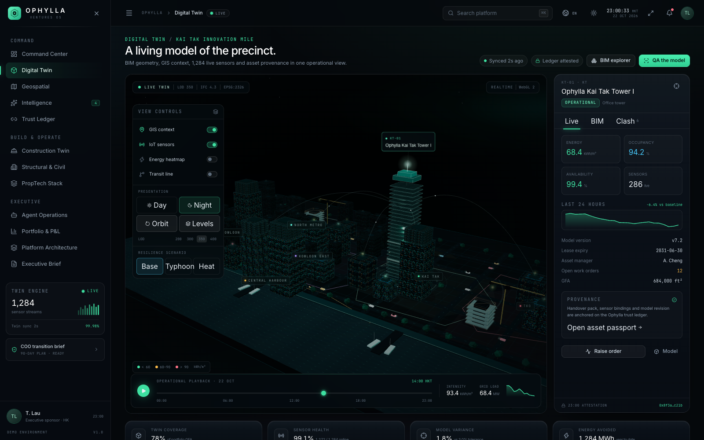

## Theme and language

- **Dark is the default.** The topbar theme control switches to a daylight palette; the 3D stages remain dark viewports for contrast and model legibility.
- **Eight languages:** English, 繁體中文, 简体中文, Español, Français, 日本語, Deutsch and 한국어.
- The language menu is in the topbar and is persisted locally. The document `lang` attribute is set for accessibility and correct CJK font fallback.
- Navigation, page narratives, primary actions, 3D control labels and the new operating modules are localized. Technical asset, sensor and model fields remain in English as system-of-record data labels.

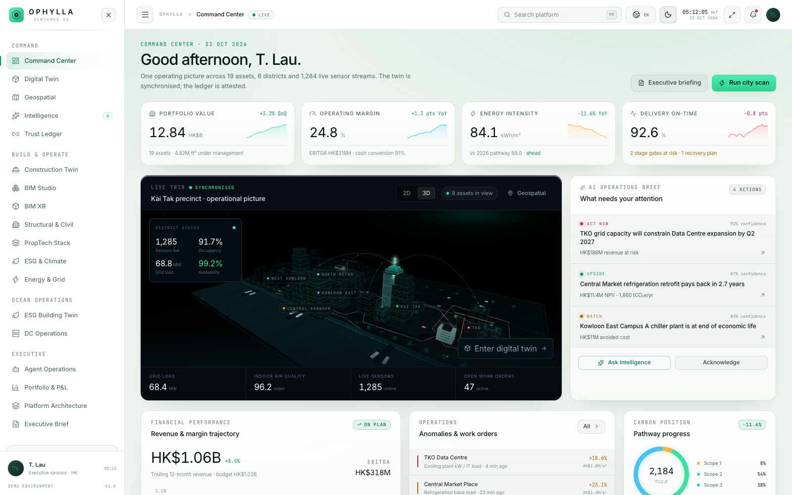

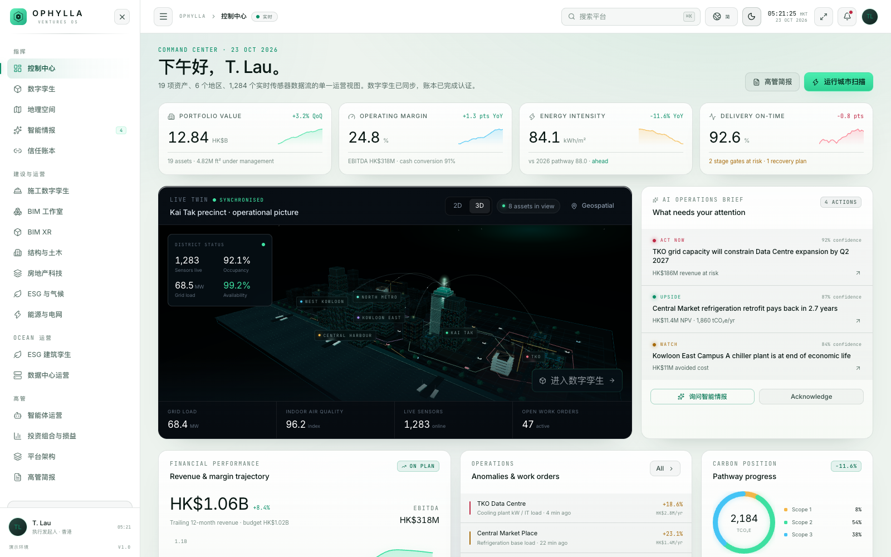

## New 3D studios

The **Command Center** now opens in an interactive 3D city with the same 2D analytical map one click away. Orbit the precinct, read district labels, click a building and enter the twin.

### Offsite factory — build the building in a factory
A 3D prefabrication factory: robotic weld cells, MEP fit-out, finishing, glazing, in-line quality, conveyor, AGVs, dispatch and digital work instructions. Switch Line / Automation / Quality / Carbon and base, surge or automation-step scenarios.

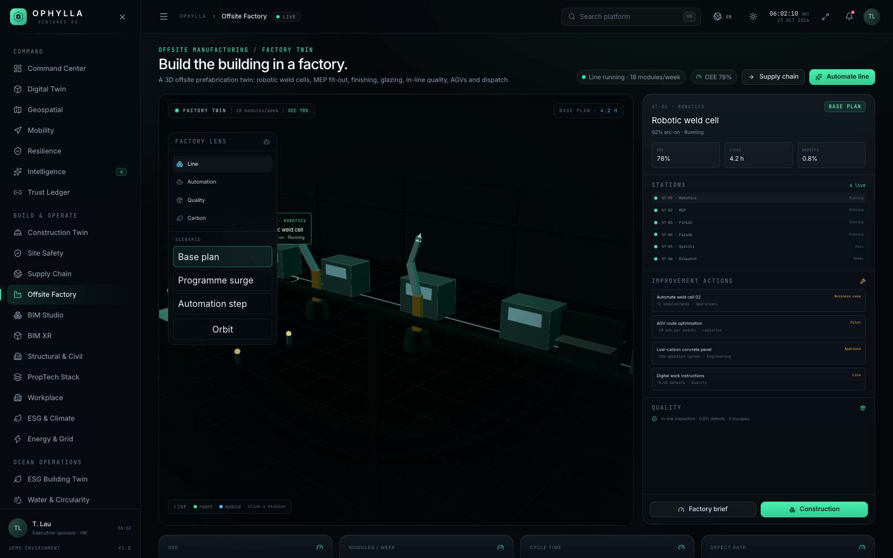

### Waste & circularity — nothing is wasted
A 3D construction waste yard: concrete, steel, timber, glass, MEP and mixed streams; skips, crusher, conveyor and recovery. Switch Streams / Diversion / Carbon / Market and baseline, demolition or retrofit scenarios.

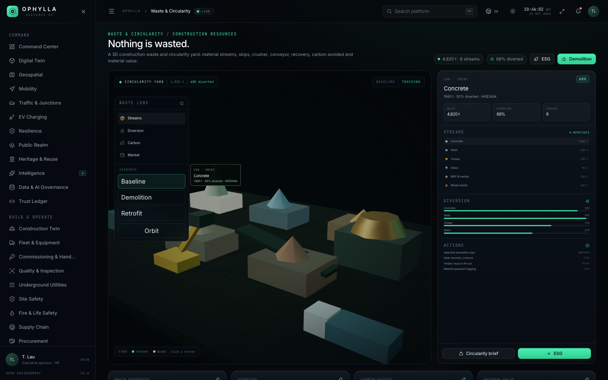

### Contracts & claims — every obligation, visible
A 3D contract portfolio: six contracts, parties, obligations, claims, time bars and renewals. Switch Obligations / Claims / Time bars / Renewals and base, major-claim or dispute scenarios.

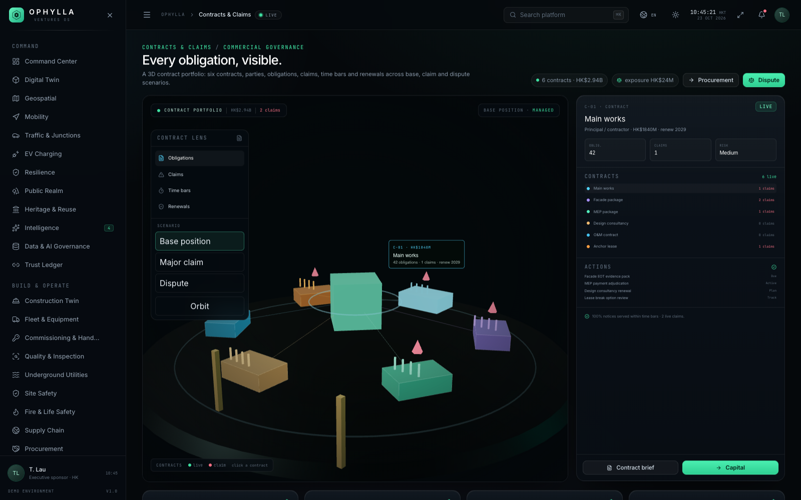

### Procurement — buy well, build better
A 3D procurement control tower: six tender packages, bidder nodes, award gate, tender savings and single-source risk. Switch Pipeline / Award / Risk / Savings and base, fast-track or supply-shock scenarios.

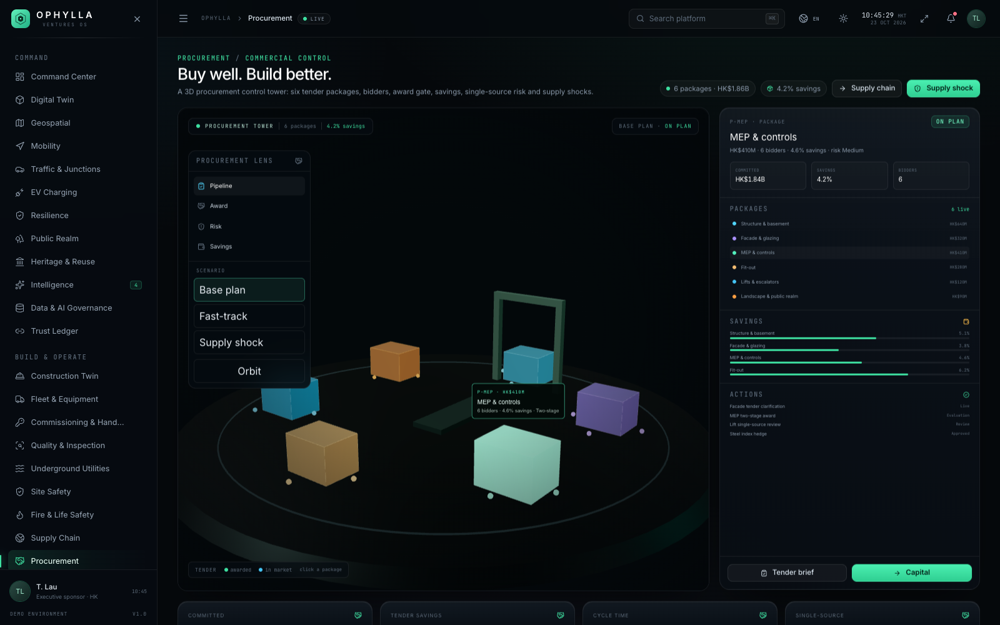

### Global supply chain — source the world, deliver the site
A 3D globe for prefab, steel, MEP, facades and AV systems: supplier nodes, sea/air/road lanes, inventory cover, concentration risk and lane carbon. Switch Suppliers / Logistics / Inventory / Risk / Carbon lenses and normal, port congestion or typhoon scenarios.

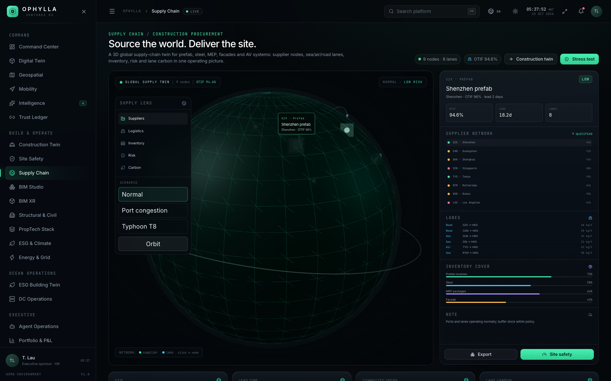

### Fire & life safety — seconds matter
A 3D fire-safety twin: floor compartments, detection, sprinklers, smoke extract, evacuation stairs and fire-service access. Switch Detection / Egress / Suppression / Structure and apartment, kitchen or basement fire scenarios.

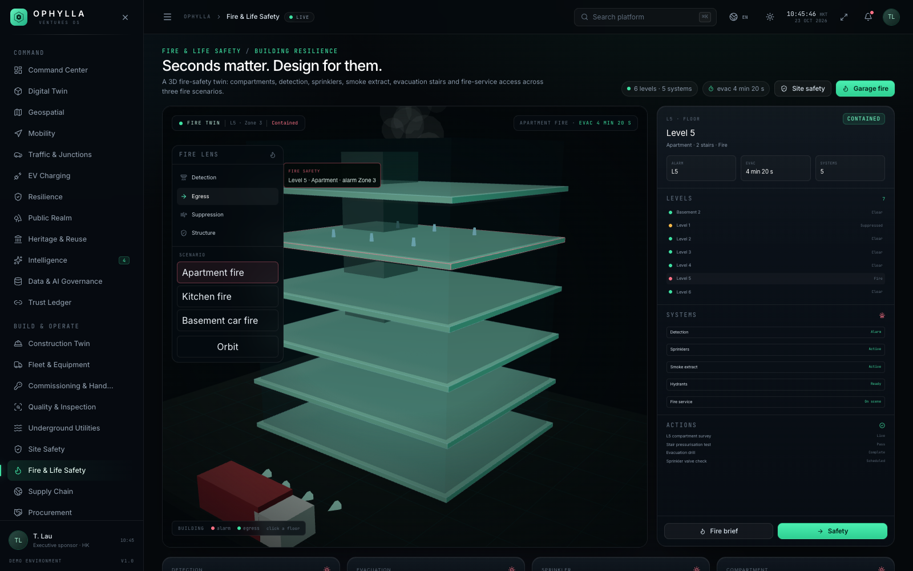

### Construction safety — everyone home safe
A 3D safety command view for the live site: hazard zones, crane slew and suspended-load exclusion, hot works, fire points, evacuation route and assembly point, typhoon readiness and permit-to-work. Switch Hazards / Crane / Fire & evac / Weather lenses and normal, critical lift, fire drill or typhoon scenarios.

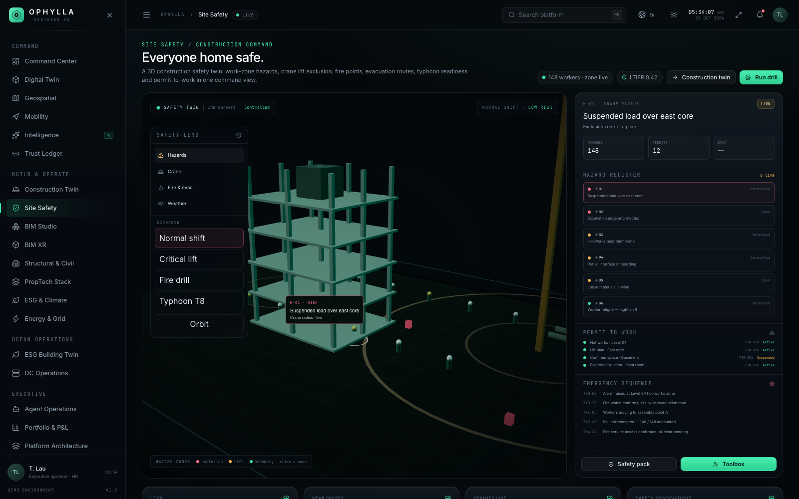

### Underground utilities — what lies beneath
A 3D utilities corridor: water, power, telecom, gas, drainage and district cooling. Switch Network / Clashes / Depth / Sensors and base, excavation or water-burst scenarios.

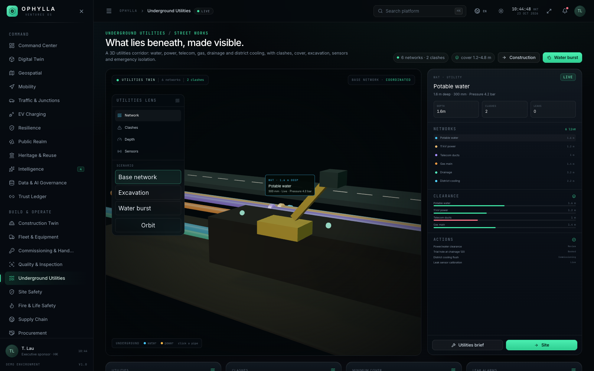

### Quality & inspection — right first time
A 3D construction-quality twin: four floors, defect pins, drone scans and NCR gate. Switch Inspections / Defects / NCR / Rework and concrete, steel or fit-out scenarios.

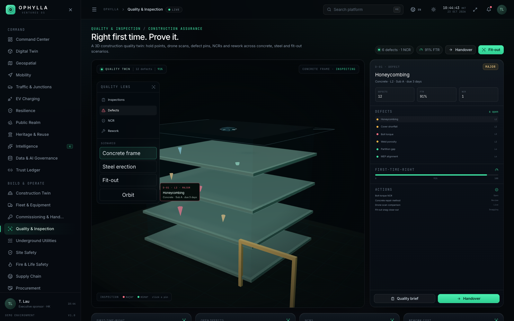

### Commissioning & handover — finish strong
A 3D close-out twin: six systems, tests, snags, asset tags, O&M and the handover gate. Switch Commissioning / Snags / Assets / Handover and pre-handover, punch-list or ready scenarios.

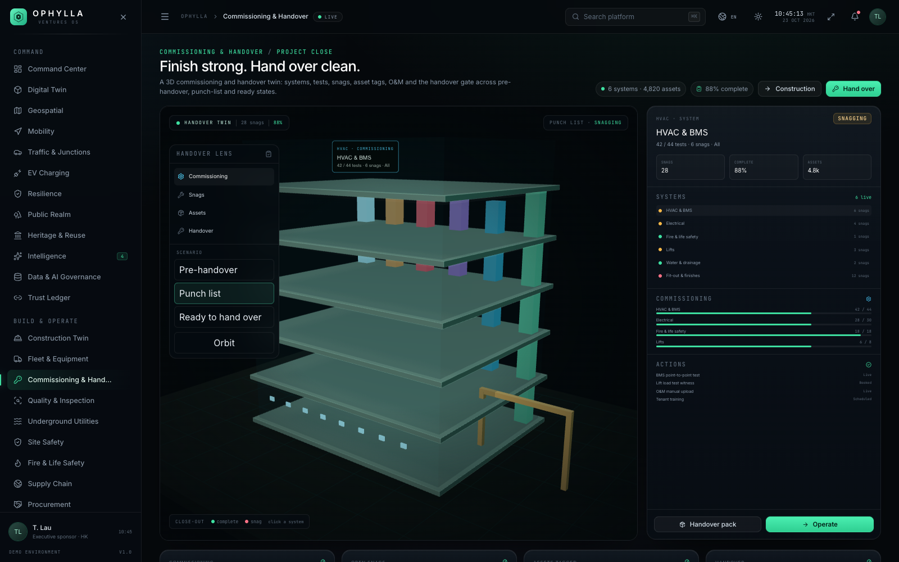

### Fleet & equipment — every machine, accounted for
A 3D construction plant yard: tower crane, excavators, wheel loader, telehandler, generator and survey drone. Switch Fleet / Utilisation / Maintenance / Emissions and peak, wet-weather or breakdown scenarios.

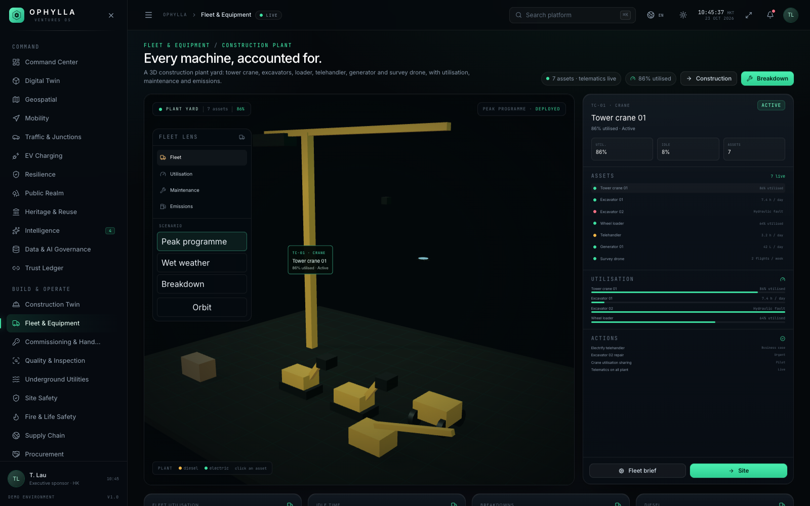

### Construction technology — 4D site twin
Move through mobilise, substructure, superstructure, envelope and fit-out. The crane slews, the excavation gives way to the frame, the drone scan surrounds the active floors and the safety geofences stay live.

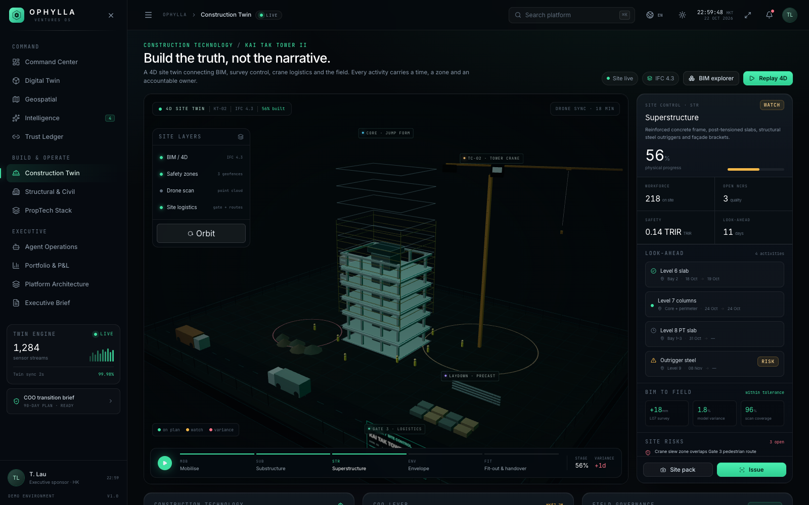

### Acoustics & vibration — design for the ear
A 3D concert-hall and workplace acoustics twin: stage, stalls, balcony, atrium, office and plant; reflectors, rays, RT, noise, speech privacy and rail vibration. Switch Room acoustics / Vibration / Noise / Privacy and concert, office or rail scenarios.

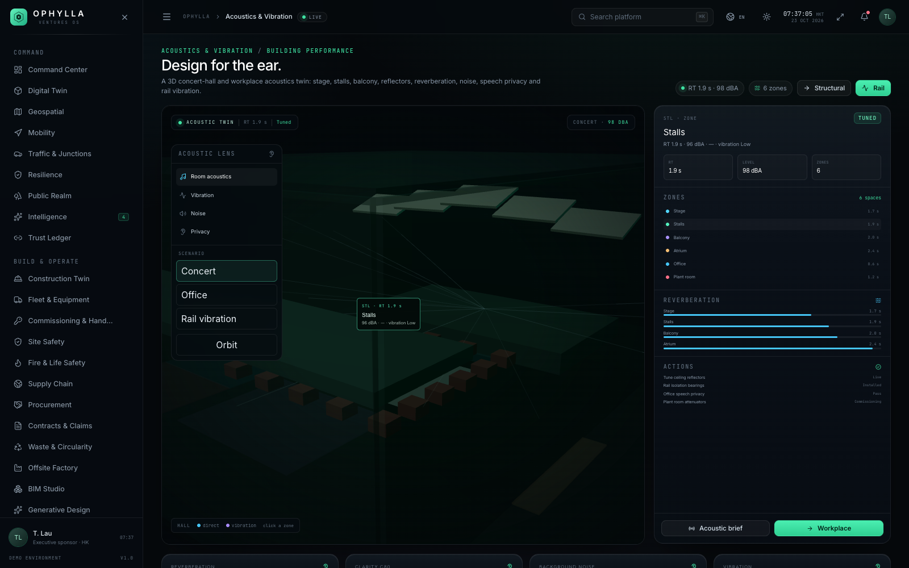

### Seismic resilience — design for the ground that moves
A 3D seismic structural twin: base isolators, viscous dampers, an eight-storey frame, drift, acceleration and damage. Switch Drift / Isolation / Damping / Damage and minor, moderate or major earthquakes.

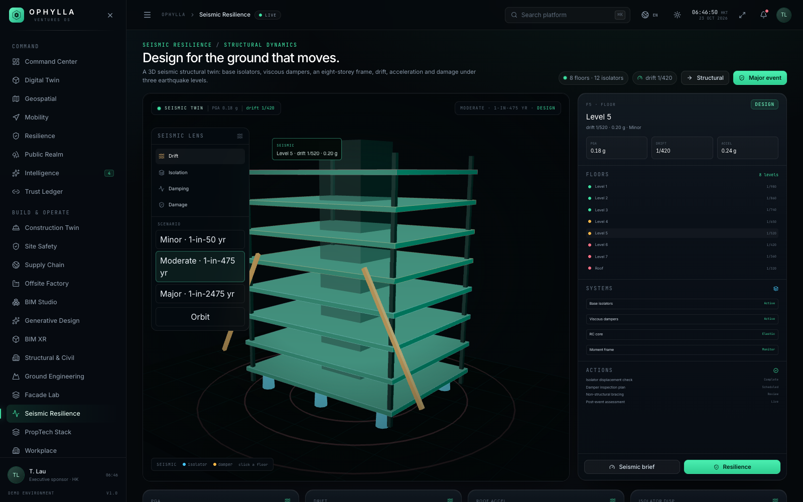

### Facade lab — the envelope is the building
A 3D unitised facade mock-up: glass panels, mullions, brackets, thermal break and section layers. Test thermal, structural, water and installation performance under design wind, driving rain or solar gain.

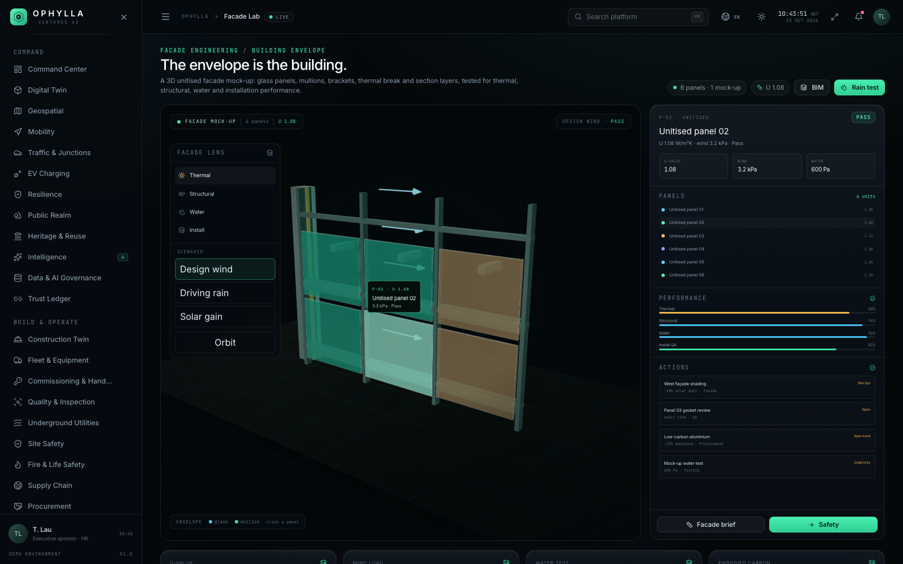

### Ground engineering — build on solid ground
A 3D geotechnical ground model: fill, marine clay, alluvium, decomposed granite and bedrock; boreholes, groundwater, pile group, settlement contours and deep-excavation scenarios.

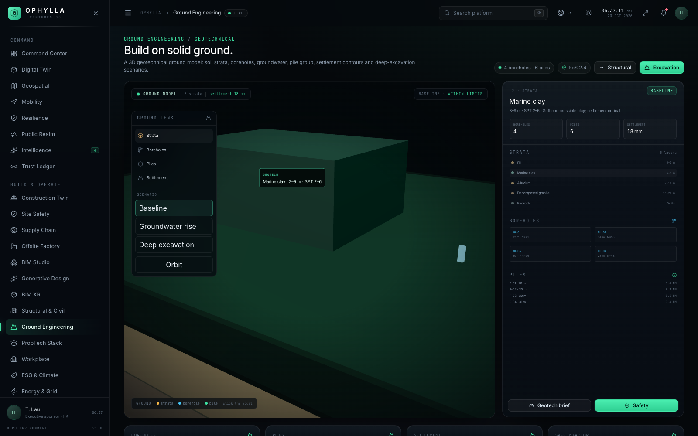

### Structural & civil engineering — design assurance
Switch load cases and watch utilisation propagate through the frame; exaggerate the deflected shape; open the geotechnical inset; or cross the harbour link while the deck responds to the 32 t test vehicle.

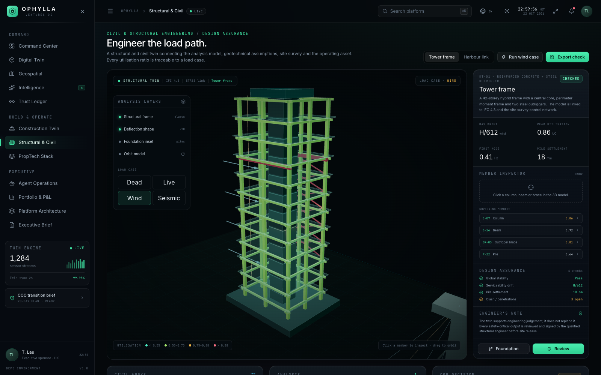

### Workplace — the building, as a service
A 3D smart workplace floor: desks, meeting rooms, focus pods, forum, café and reception with live occupancy, comfort, energy and booking layers. Switch Occupancy / Comfort / Energy / Bookings and morning, peak or after-hours scenarios.

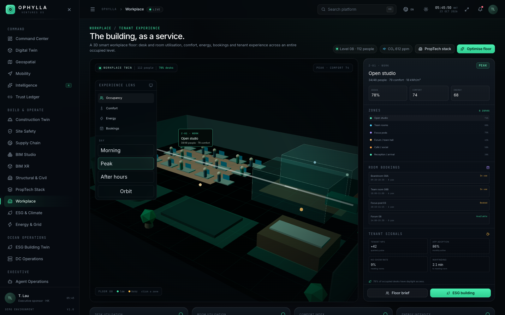

### PropTech — every square metre, legible
A 16-floor cutaway coloured by the leasing, occupancy, energy or experience lens. Select a floor to inspect tenant, rent, expiry and area, or explode the stack to read the asset plan.

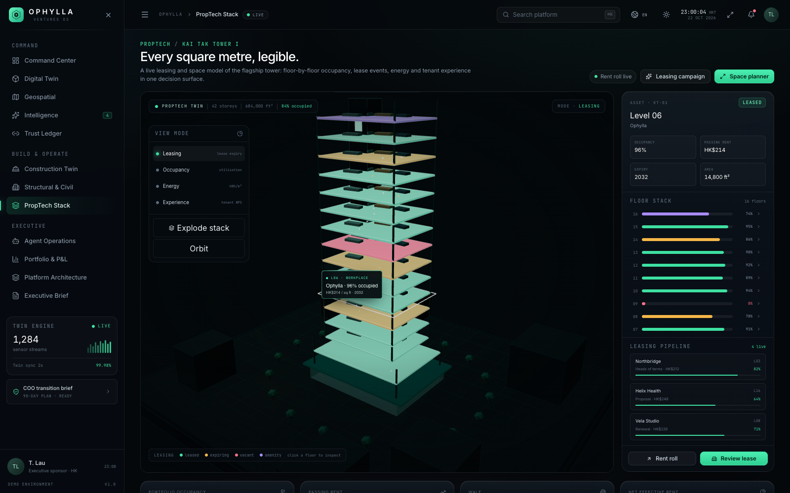

### ESG & climate — the spatial sustainability layer
A new 3D low-carbon district connects operational carbon, embodied carbon, climate risk and nature. Switch between **Carbon** and **Nature & people**, then step the pathway from 2026 baseline to 2030 transition to 2045 net zero. Select any building to inspect its carbon, energy, water, waste, certification and social profile.

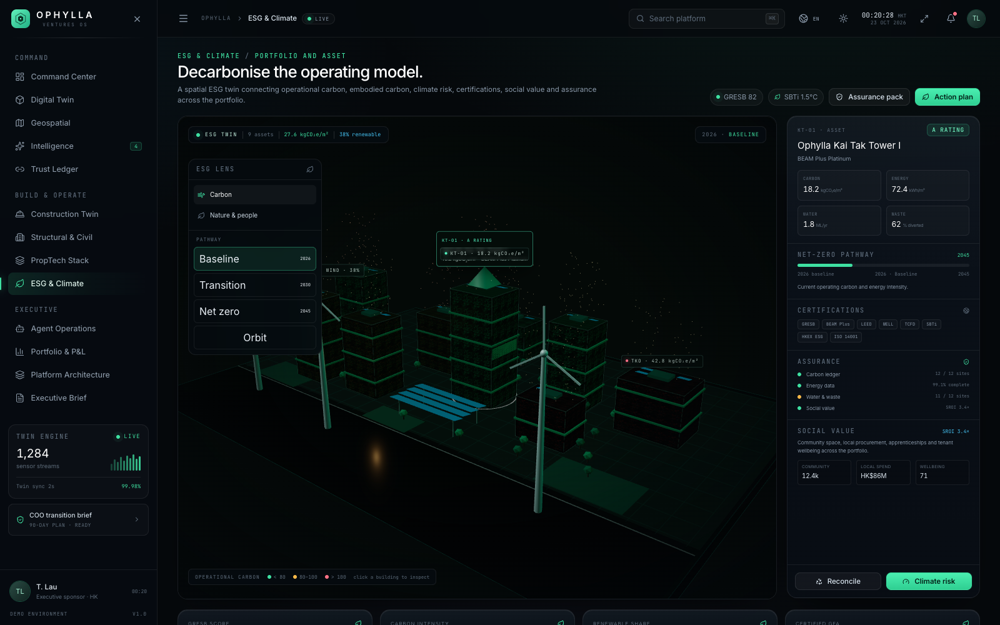

### Resilience — the city before, during, after
A 3D emergency-operations twin: typhoon wind and rain, storm surge and flood extent, power outages, shelters, hospitals, pumps, vulnerable assets and emergency response routes. Switch Flood / Wind / Power / Response and T8, storm surge or grid blackout scenarios.

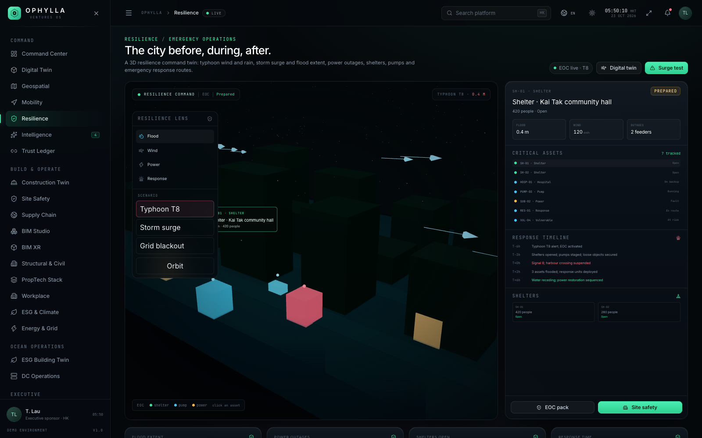

### Heritage & adaptive reuse — keep what matters
A 3D conservation-led reuse twin: masonry façade, arched colonnade, timber roof, new glass core, gallery insertions and courtyard. Switch Heritage / Structure / Adaptive reuse / Carbon and museum, office or hotel scenarios.

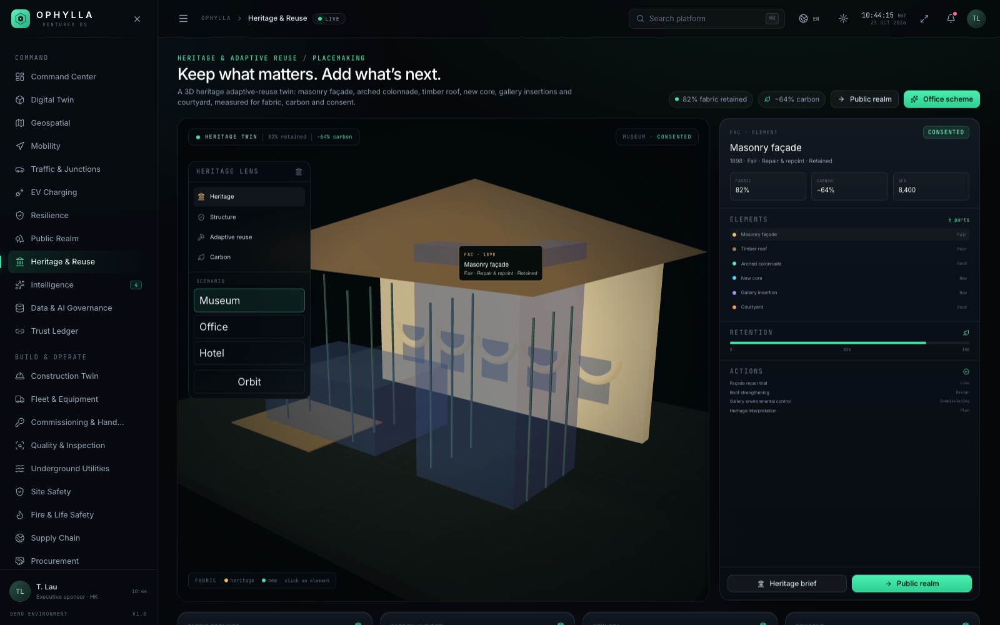

### Public realm — the city between buildings
A 3D placemaking twin: central lawn, market square, water garden, event stage, play and transit arrival with trees, paths, people and lighting. Switch Comfort / Green / Activation / Access and weekday, event or night scenarios.

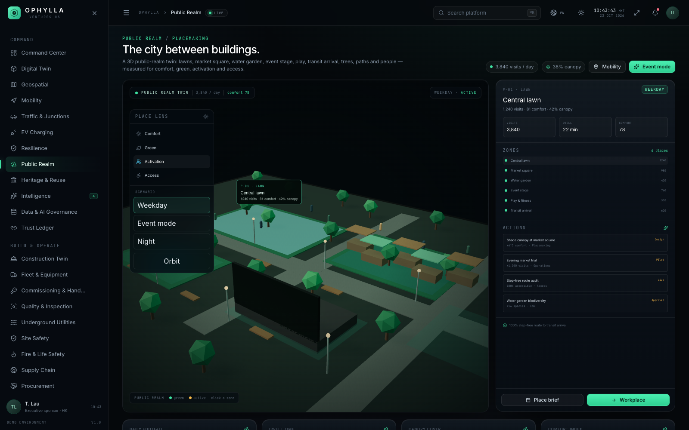

### Vehicle studio — engineered to be seen
A real-time vehicle showroom: sedan, SUV, van, bus and truck with smooth extruded bodies, clear-coat paint, shaped glazing, alloy wheels, brake calipers, interiors, lights and studio reflections. Six paints, three wheel finishes and five camera views.

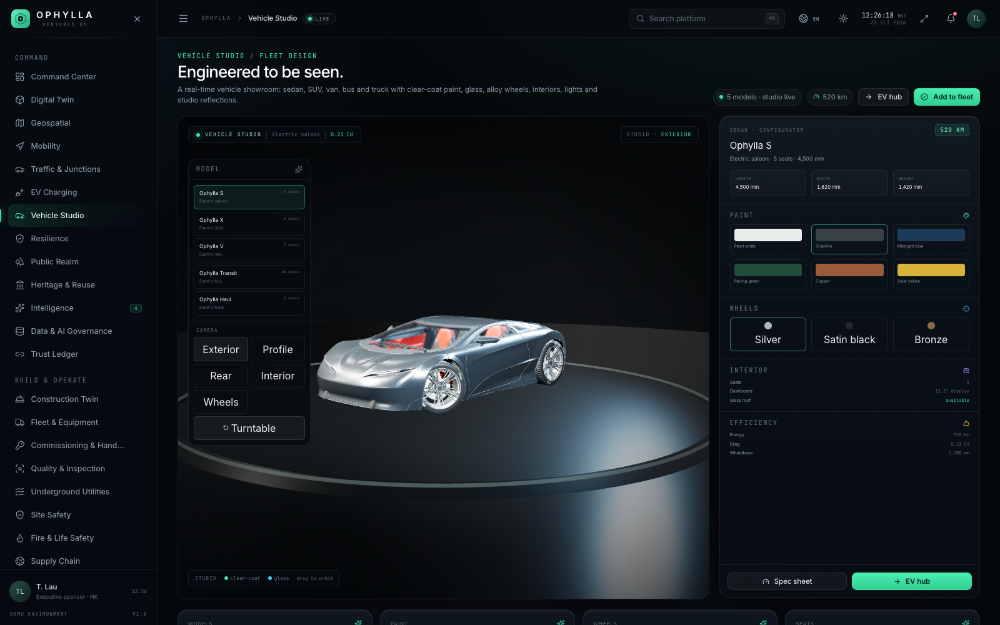

### EV charging — charge the fleet, protect the grid
A 3D charging hub: solar canopy, six DC/AC chargers, vehicles, battery storage and grid connection. Switch Charging / Energy / Grid / Maintenance and evening peak, solar surplus or grid outage scenarios.

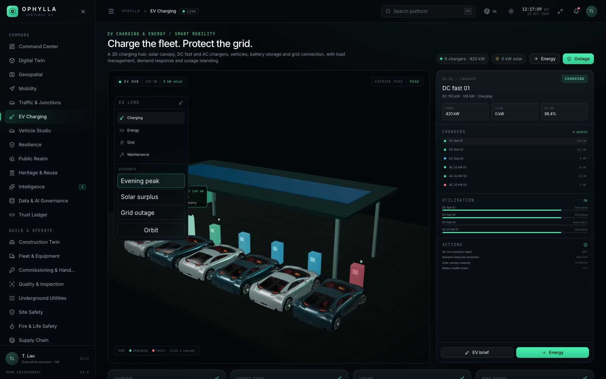

### Traffic & junctions — every movement, choreographed
A 3D city intersection: adaptive signals, cars, bus, cyclists, pedestrians and surrounding buildings. Switch Flow / Safety / Transit / Emissions and AM peak, event egress or incident scenarios.

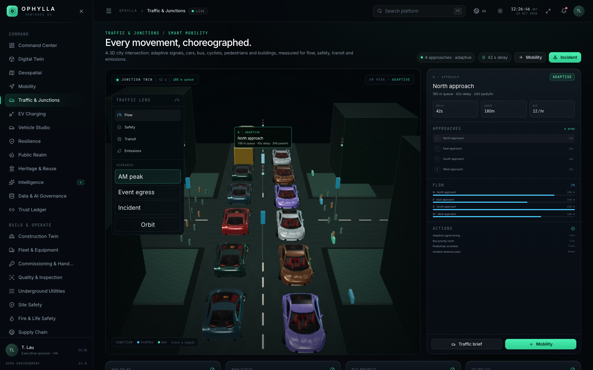

### Smart-city mobility — move the city, not just the traffic
A 3D mobility twin for the Kai Tak precinct: autonomous shuttles on a 6.4 km loop, MTR feeder bus, rail interchange, harbour ferry, survey drones, EV charging, dynamic curb zones and adaptive signals. Switch Traffic / Autonomous / Transit / Curb & EV / Carbon lenses and AM peak, event egress or incident scenarios. Click any vehicle, station or hub for operating data.

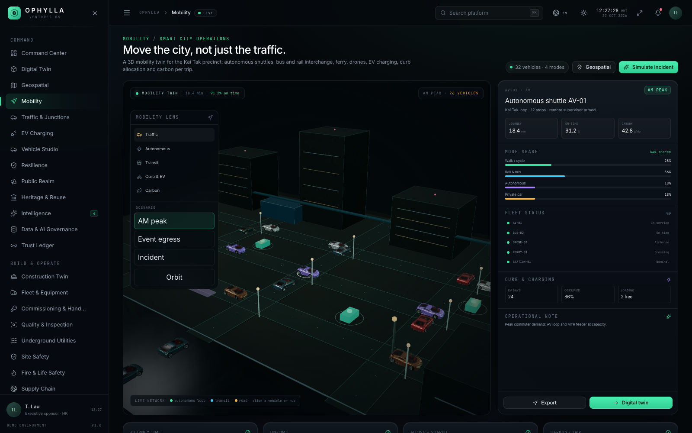

### Geospatial 3D — from map to model
The Geospatial module now opens in an interactive 3D GIS mode with the same asset selection, district labels and layer controls as the 2D analytical map. Toggle back to 2D at any time.

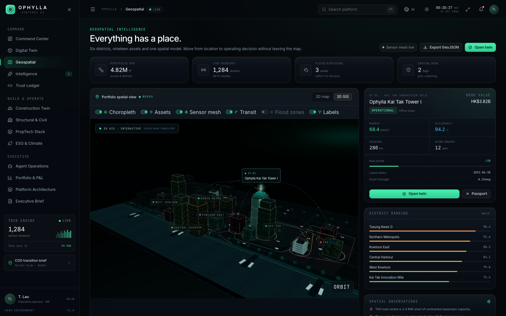

### Port & logistics — the city's front door
A 3D container-terminal twin: vessel, ship-to-shore cranes, yard blocks, trucks, rail, gate and quay. Switch Throughput / Berth / Landside / Emissions and normal, peak or typhoon scenarios.

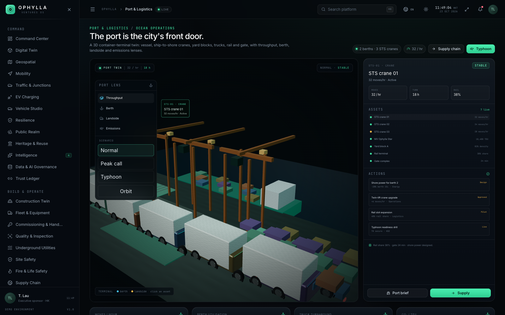

### Water & circularity — every drop accounted for
A 3D water utility twin: reservoir, treatment basins, pump station, water tower, pipe network, acoustic leak detection, quality sensors and greywater recovery. Switch Supply / Quality / Leaks / Circularity and normal, drought or major-leak scenarios.

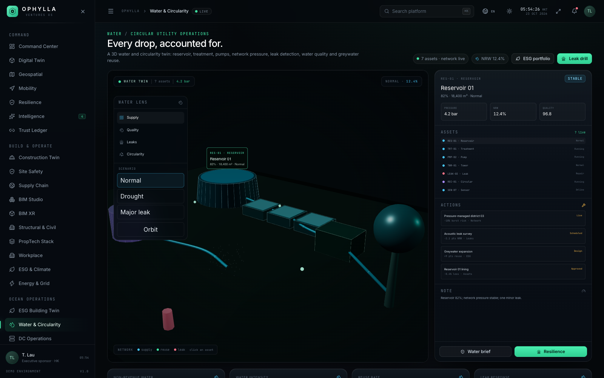

### Maintenance & work orders — fix it before it fails
A 3D maintenance twin: four floors, work-order pins, technicians, parts, SLA rings and BMS triggers. Switch Work orders / SLA / Parts / Technicians and reactive, PPM or emergency scenarios.

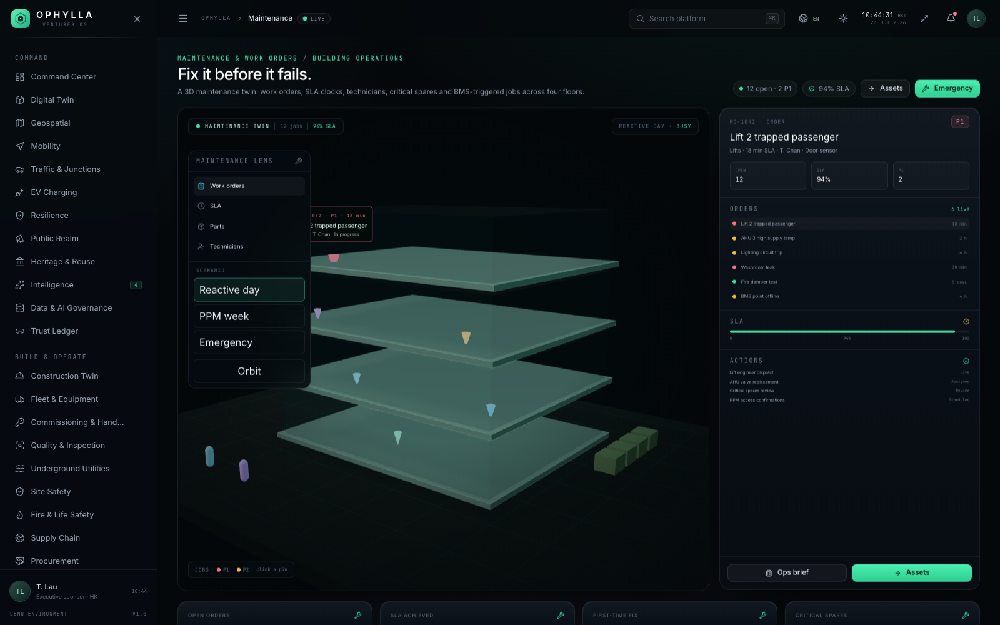

### Asset lifecycle — know what you own
A 3D estate asset twin: structure, façade, MEP, lifts, ICT and fit-out with condition, remaining life, capex and criticality. Switch Condition / Lifecycle / Capex / Criticality and maintain, replace or retrofit scenarios.

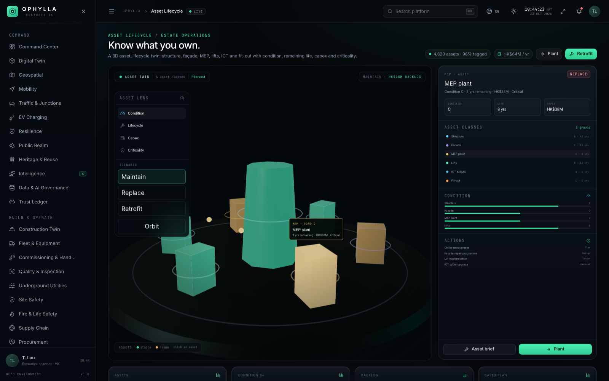

### Electrical distribution — power, controlled end to end
A 3D electrical room: transformers, LV switchgear, busbars, ATS, UPS, capacitor bank and standby generator. Switch Distribution / Load / Power quality / Reliability and normal, peak or outage scenarios.

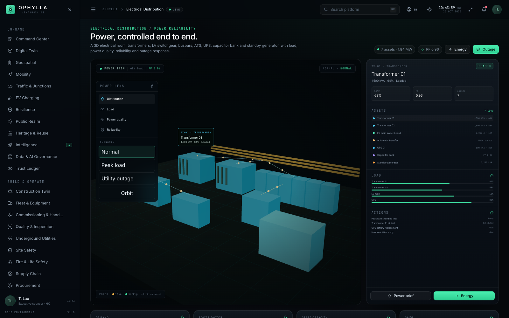

### Plant & BMS — the plant room, under control
A 3D building-services twin: chillers, chilled-water pumps, cooling tower, AHU, BMS controller and pipework. Switch Cooling / Energy / Water / Maintenance and normal, peak or chiller-fault scenarios.

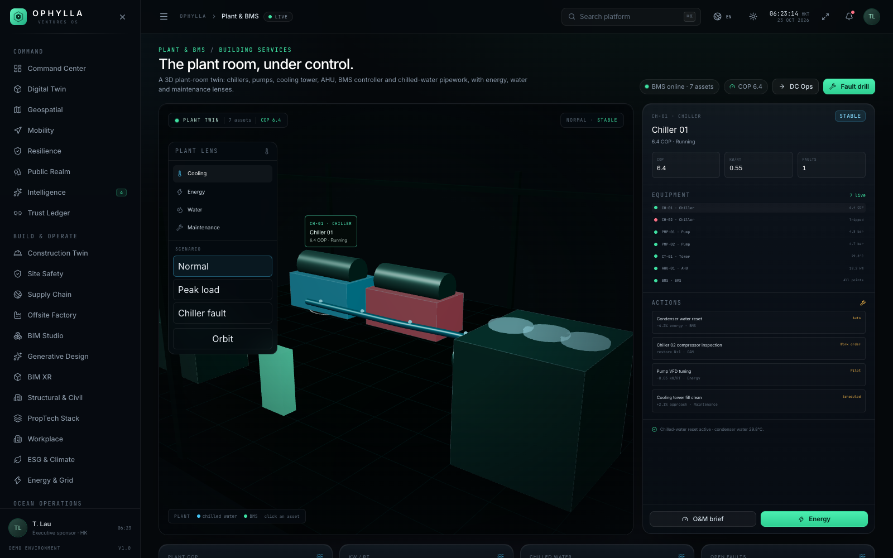

### OCEAN operations — ESG building and data centre
Two dedicated OCEAN-style operating demos:

- **`/esg-building`** — a 12-storey 3D ESG building twin with floor-by-floor energy, carbon, water and wellbeing lenses; Current → Retrofit → Net zero scenarios; rooftop solar, chiller, AHU, rainwater tank and battery; certification and AI retrofit actions.
- **`/dc-ops`** — a 3D data centre operations twin with AI energy optimisation, cooling analytics, predictive maintenance alerts, capacity planning, open partner ecosystem and rack-level telemetry. The operating pattern is benchmarked against NTT OCEAN Intelligence-style smart-building architecture: intelligent core platform, open management overlay and partner applications.

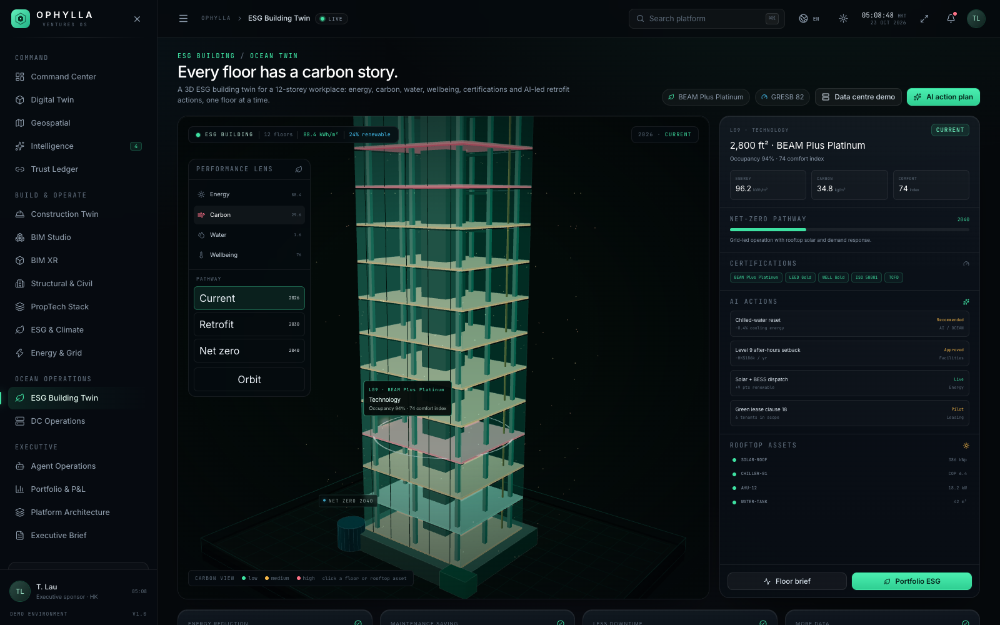

### ESG World Model — see the whole life of a building
A causal world model for a Kai Tak precinct that connects four normally separate domains: **construction technology** (4D logistics, site transport and waste), **BIM** (quantities and material passports), **civil/structural engineering** (concrete, steel, facade and adaptation choices) and **PropTech** (occupancy, green leases and tenant behaviour).

Move the 2026–2050 timeline; toggle ten levers such as low-carbon concrete, steel reuse, high-performance facade, heat pumps, solar, circular fit-out, low-GWP refrigerant and climate adaptation. The model recalculates lifecycle carbon, energy intensity, waste diversion, social value, climate risk and green premium, and checks the 2030 carbon budget. World layers show embodied carbon, operational energy, flood/heat hazard and social value in the 3D precinct.

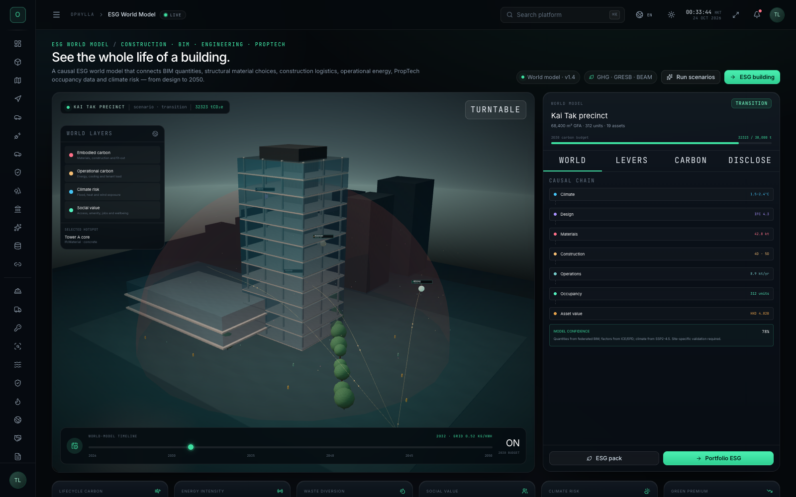

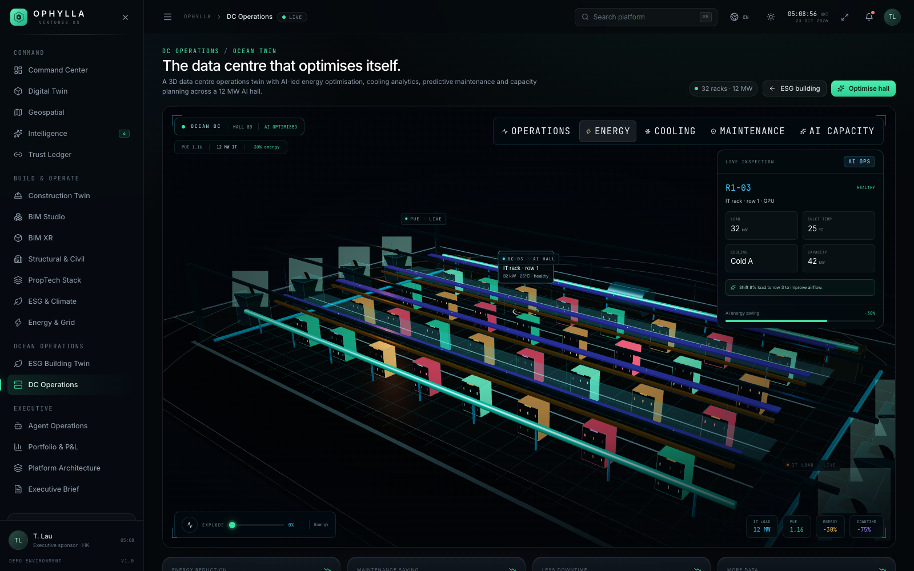

Reference: [OCEAN Intelligence by NTT](https://www.oceanintels.ai/) — intelligent core platform, open management overlay and partner ecosystem for smart building operations. No affiliation implied.

### BIM XR — holographic data-centre twin
A cinematic, full-viewport BIM XR experience for a 12 MW AI data hall. The model contains 32 IT racks, cold-aisle containment, overhead cable trays and busways, CRAC units, UPS/PDU, chillers and cooling loops.

- **Five modes:** Overview, Power, Cooling, Network and AI capacity
- **Exploded view** slider separates structure, trays, containment, racks, floor and cooling
- **Click any rack, CRAC, UPS, PDU or chiller** for live telemetry
- **AI design copilot:** choose AI factory, cloud hall or colocation, or generate a layout from a prompt
- **Holographic scan plane, floor rings, data particles, glass HUD and corner framing**
- **BIM data:** IFC objects, LOD 400, federated model and COBie asset linkage

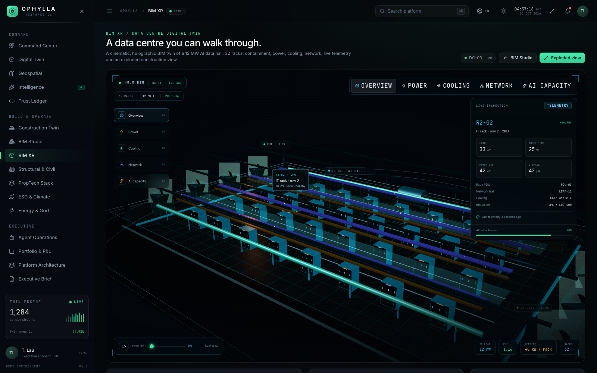

### Generative design — many futures, one decision
Three massing options side by side: twin towers, stepped terraces and courtyard mid-rise. Compare GFA, FAR, height, units, daylight, embodied carbon, cost and public realm, then carry the selected option into BIM.

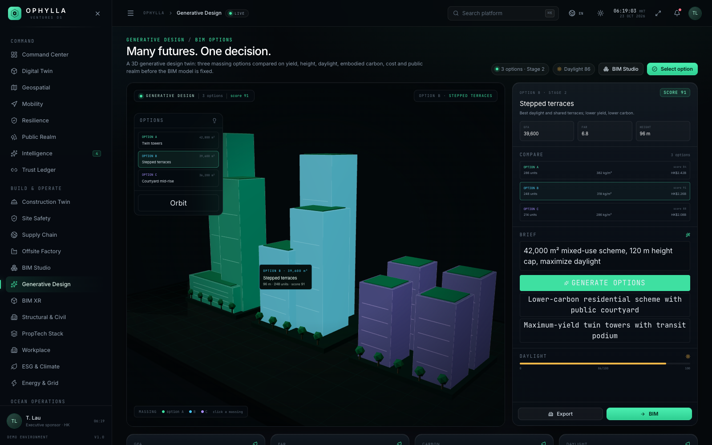

### BIM Studio — construction site coordination
A dedicated construction-site BIM demo built around the same workflow described in common BIM service practice: 3D design review, MEP–FP coordination, clash detection, LOD 500 asset data and 4D scheduling. The 3D scene includes architecture, structural frame, MEP ducts and risers, fire protection, site logistics and a tower crane.

Use the **discipline filters**, **LOD 200/350/500**, **six-stage 4D timeline**, and the **clash register**. Click any element, MEP asset or clash marker to inspect its object data, owner, distance, recommendation and COBie handover fields. The federation panel tracks five discipline models, and the BIM uses panel covers visualization, coordination, clash detection, 4D, COBie/FM, quantity takeoff, prefabrication and as-built handover.

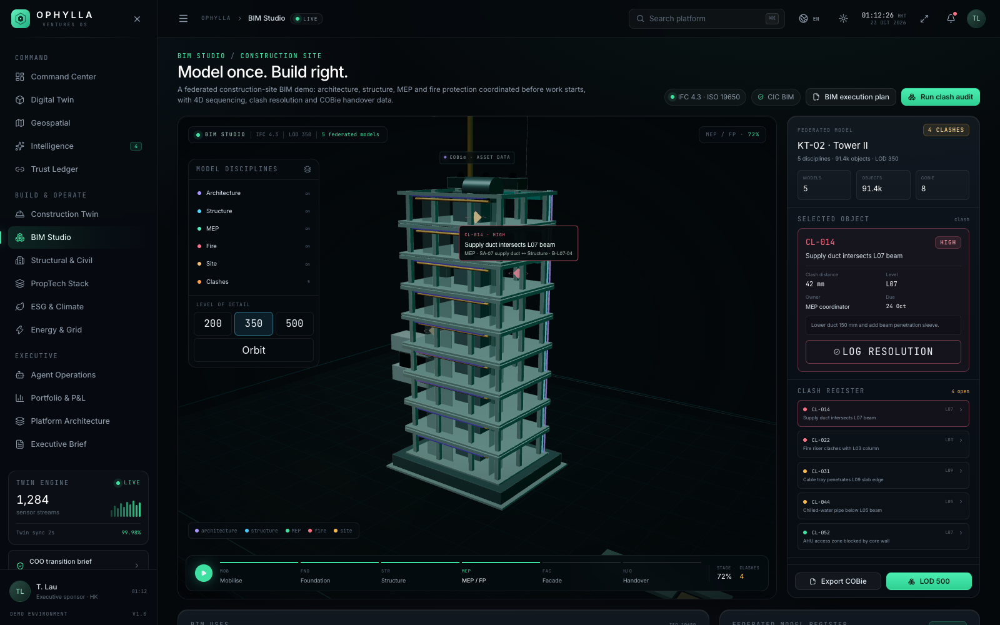

### BIM on Site — Kai Tak Tower A
A professional site-based BIM demo set on a live Kai Tak construction site. The scene shows the real construction condition: podium and tower frame, partial curtain wall, scaffolding, two tower cranes, site offices, hoarding and gate, rebar and precast laydown, excavator, delivery truck, workers and floodlights — with neighbouring Kowloon blocks and the harbour beyond.

Switch between **Day** and **Dusk**, and between **Site**, **BIM** and **As-built** views; filter structure, architecture, MEP, facade, civil and temporary works; scrub the **4D sequence** from mobilisation to handover; inspect **clashes**, **model versions**, **quantities** and **site logistics**. The project data covers 486,200 elements, 18 federated models, ISO 19650 CDE states, LOD 350, 47 open clashes, 428 workers and 38 daily deliveries.

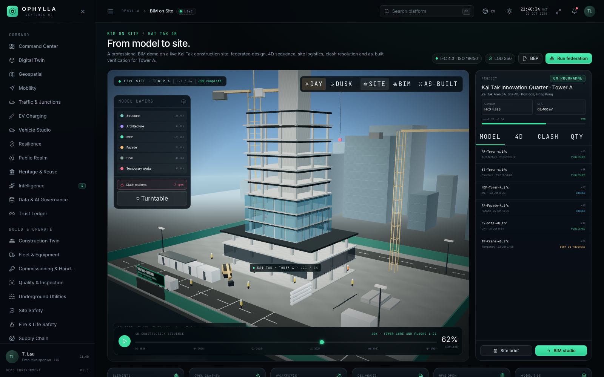

### BIM Workflows — ten tools, one federated truth
A professional toolchain demo covering the ten BIM tools and workflows in Parametric Architecture's editor's pick: **Autodesk Revit, ArchiCAD, SketchUp, Rhino + Grasshopper, Vectorworks and AutoCAD** for authoring; **Plannerly** for BIM management and information requirements; **Trimble Connect** as the CDE; **Revizto** for interactive design review; and **BIMcollab** for BCF issue management.

The 3D model graph connects every tool to the federated building, with live data packets, workflow-stage filtering and clickable tool nodes. The module also includes a BCF issue register, COBie handover, and **Proptech.AI** operations: app-less onboarding, facial recognition, visitor management, people counting, peak-hour analytics and integration with existing card systems.

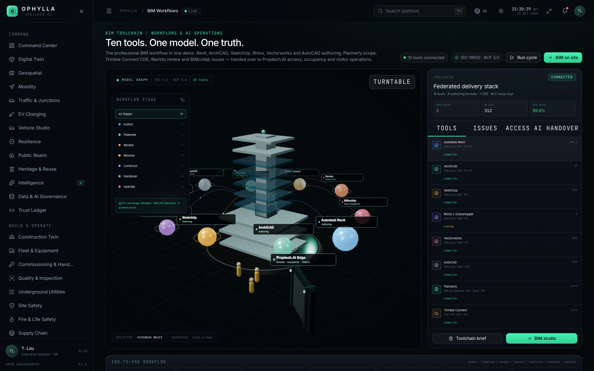

Reference toolchain: [10 best BIM tools and workflows](https://parametric-architecture.com/10-best-building-information-modeling-bim-tools-and-workflows/) · [Proptech.AI](https://proptech.ai/)

Reference workflow: [How BIM Modeling Transforms Construction Projects](https://www.united-bim.com/bim-modeling-improves-construction-efficiency/) (United-BIM). The demo adapts the common BIM service pattern — Revit/IFC models, MEP–FP coordination, clash detection, LOD 500, 4D and COBie — into the Ophylla operating environment.

### Energy & grid — EcoOps microgrid
A live electrical twin for the Kai Tak precinct: the CLP 11 kV connection, transformers, LV switchgear, battery storage, solar canopy, wind turbines, generators, data-centre load, chillers and EV charging. Run **Normal**, **Peak shave**, **Island mode** and **Carbon sprint** scenarios; watch power flows reroute, the grid trip, BESS carry the island and the generators synchronise.

The module includes a four-layer **EcoOps reference stack** (connected products → edge control → apps & analytics → services), Hong Kong grid/compliance framing (CLP/HKE, IEC 61850, IEC 62443, ISO 50001, BEAM Plus, CIC BIM Standards) and an island black-start sequence.

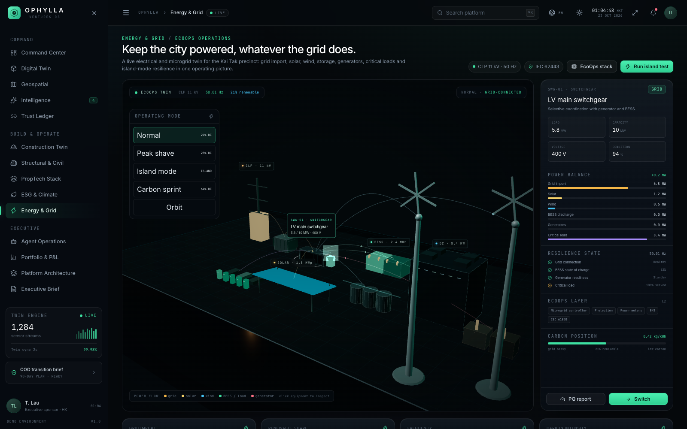

### Cyber & OT — trust the network, verify everything
A 3D IT/OT security twin: cloud, corporate apps, BIM CDE, BMS, SCADA, IoT, identity, SOC, backup and vendors. Four lenses — Network, Zones, Threats, Response — plus phishing, ransomware and OT-intrusion scenarios with attack paths, blast radius and containment.

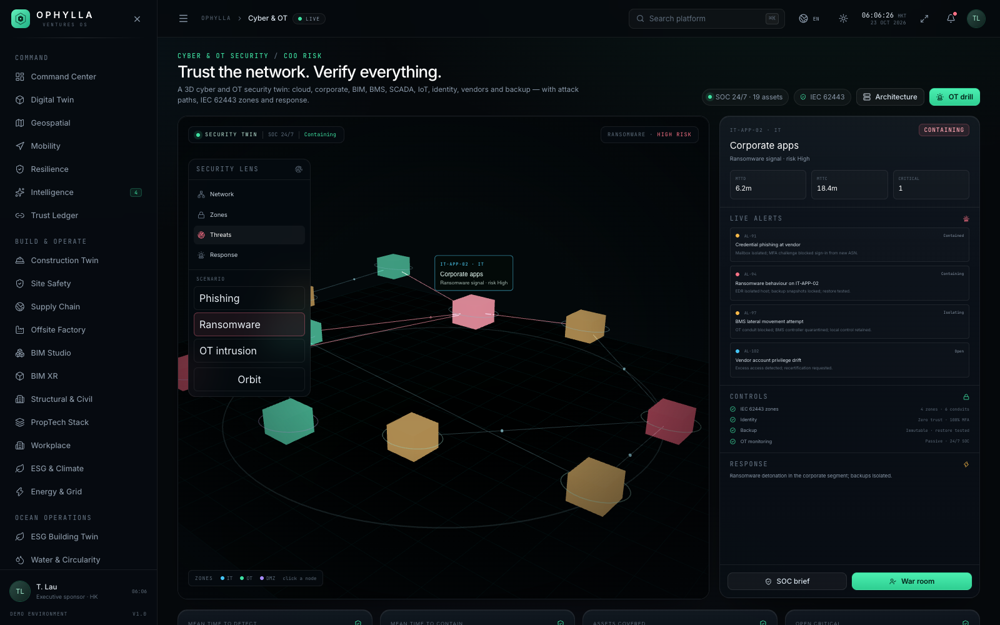

### Innovation lab — invent the next operating model
A 3D innovation lab: six ventures around an AI core, with experiments, TRL, capital, IP and value. Switch Portfolio / Experiments / IP / ROI and AI, robotics or energy scenarios.


### Deal room — buy, build, or walk away
A 3D corporate-development deal room: acquisition target, six diligence workstreams, IC gates, synergy rings and bid stages. Switch Pipeline / Diligence / Synergies / Risk and acquisition, divestment or JV scenarios.


### Insurance & risk — protect the downside
A 3D insurance programme: six policies, limits, deductibles, premiums, claims and catastrophe exposure. Switch Coverage / Claims / Premiums / Cat risk and base, typhoon or cyber scenarios.


### Capital & investors — capital with conviction
A 3D capital-stack twin: green grant, equity, mezzanine and senior debt linked to investors, returns, LTV, DSCR, covenants and use of proceeds. Switch Capital stack / Returns / Risk / Investors and base, upside or downside scenarios.


### People & talent — the operating model is people
A 3D organisation and talent graph: COO, seven functions, headcount, capacity, critical skills, open roles, succession and people actions. Switch Organisation / Skills / Capacity / Hiring and growth, restructure or attrition scenarios.


### Data & AI governance — trust the data, then the agents
A 3D data mesh: seven domains, 102 products, quality, lineage, access policy and AI model nodes. Switch Domains / Quality / Lineage / Access and audit, AI-enablement or access-breach scenarios.


### Agent war room — eight minds, one accountable decision
A 3D room with eight AI specialists around a holographic decision table. Run a crane incident, quarter close or design review; each agent contributes a signal, analysis, challenge or decision. The transcript, evidence links, human gates and final COO approval stay on screen.


### COO agent operations — a company that thinks in parallel
Eight specialist agents surround the COO orchestration core. Run the Q4 operating review and the council works through financial close, delivery gates, model assurance, leasing, risk, carbon, capacity and client success — pausing at four named human gates before it assembles the board pack.


## Professional capability coverage

- **Smart city:** digital twin, GIS, IoT/OT, AI operations, resilience scenarios, trust ledger, ESG and executive command.
- **Construction technology:** 4D sequence, reality capture, BIM-to-field, safety geofences, site logistics, 5D earned value and ISO 19650 CDE.
- **BIM:** IFC 4.3, Revit-style discipline models, MEP–FP coordination, clash detection, LOD 200/350/500, model federation, 4D scheduling, COBie handover and an ISO 19650 common data environment.
- **BIM XR / data centres:** holographic data-hall twin, rack density, containment, power and cooling distribution, AI capacity planning, exploded BIM and live telemetry.
- **OCEAN operations:** building-level ESG twin, floor-level carbon and energy, AI retrofit actions, data-centre energy optimisation, predictive maintenance, open data ecosystem and facility workflows.
- **Civil / structural:** load cases, utilisation, deflection, geotechnical inset, pile settlement, bridge cable/bearing monitoring and load testing.
- **PropTech:** leasing cutaway, floor-level rent roll, occupancy and space utilisation, tenant experience, certifications and green-lease clauses.
- **Energy & grid:** microgrid operations, power monitoring, BESS, solar/wind, demand response, island mode, power quality, IEC 61850/62443 and HK grid compliance.
- **COO operations:** P&L bridge, capital allocation, stage-gate portfolio, risk heatmap, agent council, human gates and board pack.

## Stack

- React 19 + TypeScript + Vite 8
- Three.js (fifty-six vanilla scene graphs, CanvasTexture facades, custom sky, water, carbon particles and BIM overlays)
- Cinematic rendering: ACES filmic tone mapping, image-based lighting, physically based materials, soft PCF shadows, high-DPI antialiasing, reflective glass/metal and subtle procedural surface variation across all 52 scenes
- Detailed vehicles: extruded car silhouettes, clear-coat paint, glass cabins, alloy wheels, headlights/taillights, mirrors and plates for cars, vans, SUVs, buses and trucks
- Tailwind CSS v4 + a small custom design system
- React Router (hash routing, so the production build can be served from any static host)
- A small i18n layer with six locales and a persistent light/dark theme system
- Lucide icons
- Playwright Core for the local visual smoke-test scripts

No external map tiles, model CDNs or API keys are required. The 3D context, BIM model and city data are generated locally.

## Run locally

```bash
npm install
npm run dev
```

Open **http://127.0.0.1:4310**.

## Production build

```bash
npm run build
npm run serve
```

Open **http://127.0.0.1:4320**.

The zero-dependency `serve.mjs` serves `dist/` and is safe to run on a machine with only Node installed. To use a different port:

```bash
PORT=8080 npm run serve
```

## Quality checks

```bash
npm run typecheck
npm run build
```

All 59 routes are smoke-tested in production in both themes. Language switching, persistence, mobile layout and the light-theme contrast pass are covered by the local Playwright scripts. Documentation screenshots were captured with Playwright Core and the local Chrome installation.

## 3D asset credits

The vehicle showroom, EV hub, traffic junction and mobility twin use the Khronos **CarConcept** glTF sample asset as a photoreal vehicle model, licensed **CC BY 4.0**. Source: [KhronosGroup/glTF-Sample-Assets · CarConcept](https://github.com/KhronosGroup/glTF-Sample-Assets/tree/main/Models/CarConcept). The licence text is included at `public/models/LICENSE-CarConcept.md`. All other 3D geometry is procedural and original to this demo.

## Navigation behaviour

The left navigation starts **collapsed to a 72 px icon rail** so every section stays one click away while the 3D canvas keeps the remaining width. The hamburger icon in the top bar expands the 252 px panel; on desktop the content shifts, on mobile it overlays with a backdrop. The X control, the backdrop or the hamburger collapses it again, and navigating to a route closes it automatically.

## Design intent

The visual language is deliberately closer to an institutional operating environment than a generic admin dashboard: a quiet graphite palette, a single mint signal colour, amber for interventions, restrained motion, tabular numbers, and dense but legible executive information. The 3D twin is a working surface, not a hero animation.

The experience is also explicitly candid about role fit. The **Executive Brief** separates direct evidence, transferable evidence and items to confirm, and states that built-environment depth would be developed through a deliberate domain ramp and qualified partners. The point of the platform is to make the operating model visible — not to overstate the record.


## Agent operating model

The Agent Operations module is a working simulation, not a live LLM connection. It demonstrates the governance pattern: each agent has a mandate, tools, confidence, autonomy level and recent audit trail; consequential steps stop at a human gate. The COO can inspect any agent before approving, resume the run and open the resulting board pack.

The commercial, delivery, technology, finance, people and risk functions are all represented in the council, with the operating cadence and decision rights shown alongside the 3D network.


## Internationalisation notes

The i18n layer is intentionally lightweight and dependency-free: a typed dictionary, a `t(key, fallback)` helper and a persisted locale. The eight dictionaries cover the application shell, page narratives and the main controls across the Digital Twin, Construction, Engineering, PropTech and Agent Operations studios. Additional analytical copy can be added key-by-key without changing component code.

The theme system is CSS-variable based. Light mode restyles the application surface and panels, while the 3D canvas and its HUD stay on a dark palette deliberately; this preserves contrast for wireframes, point clouds and engineering colour scales.
